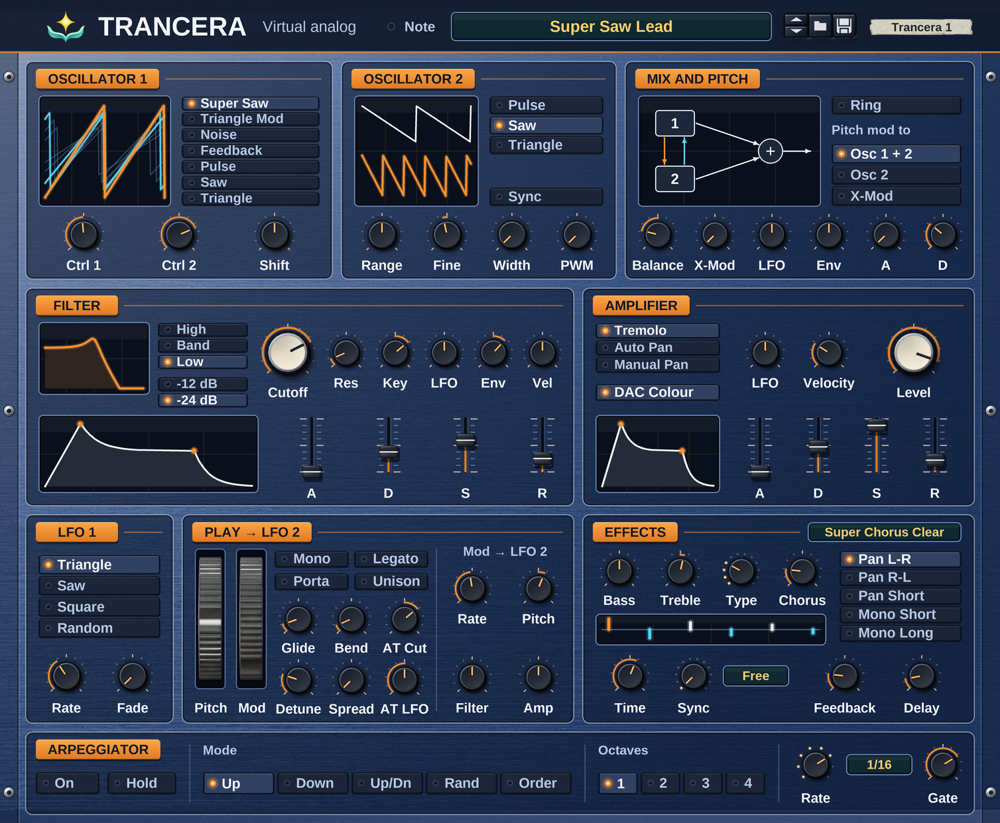

# Trancera

Trancera is a native C++17 virtual-analog synthesizer modelled on the Roland JP-8000 (1997) and JP-8080 (1998). The owner named it Trancera on 2026-11-23 (it was Hypra until then). It is an independent original implementation, not affiliated with or licensed by Roland, and holds no firmware, ROM data, samples, captured audio or factory patch data. Since 2026-11-23 it is not clean-room: at the owner's risk, constants may be taken from an analysis of the JP-8000 firmware (tagged `[firmware]`).

**Status: 0.9.2.** Its Reason Rack Extension is `Examples/Trancera` in `protocodus/reason-rack-extensions` (with a 9U 5× HD Cobalt Studio panel, 56 categorized factory presets plus 14 root highlights, and 68 automatable panel controls plus `Mono`/`Unison`, `DAC Colour`, 14-bit `Mod Wheel`, `Pitch Wheel`, `Sustain`, `Channel Aftertouch`, and auto-routed Note/Gate CV). There is no standalone VST3/AU/CLAP plug-in wrapper yet, and no Split key mode, Control Assign matrix, Arp Beat Patterns, or SysEx `.syx` importer yet.

In a 20-patch JE-8086 A/B pass on `0.9.2` (Part A, `SINGLE`, velocity matrix active, digital node), **18 of 20 factory patches** match within ≤ 2.0 dB across raw level and all three spectral bands (`< 300 Hz`, `0.3–3 kHz`, `> 3 kHz`), and **19 of 20** match within ≤ 2.2 dB.



The Rack Extension's front panel, rendered by `Design/render_panels.py`.

---

## How it works

The JP-8000 is a digital instrument: four Toshiba TC170C140 DSPs compute the voices and effects, and only the stage from the DAC to the jacks is analogue. So the model has two halves:

- **The DSP, in Q23 fixed point at 88.2 kHz.** Inside whatever host rate is active (with exact rational polyphase resampling, zero-resampler-latency passthrough at 88.2 kHz, and automatic true-idle gating), voices run in saturating 24-bit Q23 fixed point (`sat24`), 15-bit split coefficients (`mulSplit15`), 24-bit wrapping phase accumulators, and 16-bit companded delay RAM.
  - **Oscillators & modulation:** 7-saw Super Saw with tracked dual-stage HPF and measured detune curve, Saw SHAPE, Pulse/PWM, Triangle SHAPE (cubic phase skew + Chebyshev T3 wavefolder), Triangle Mod, chaotic-recurrence pitched Noise, monophonic 2-tap Feedback Osc, anti-aliased hard sync, ring mod, and linear through-zero X-Mod.
  - **Filter & Envelopes:** 2-stage saturating Chamberlin SVF (-12 / -24 dB LPF, BPF, HPF), 100 Hz stepped exponential envelopes with 12-level dynamic 88.2 kHz smoothing, dual LFOs with FADE, 40-destination JP-8080 Velocity Matrix, Filter Velocity, and MIDI Channel Aftertouch (`aftertouch_cutoff`, `aftertouch_lfo2`).
  - **Unison, Arpeggiator & Effects:** JP-8080-style **Polyphonic Unison** (`Mono = Off, Unison = On`, 2 paired voices per note = 4-note polyphony) and **Mono 8-voice Unison** (`Mono = On, Unison = On`) with live detune and equal-power **Stereo Unison Spread**, tempo-synced **Arpeggiator** (`Up`, `Down`, `Up/Down`, `Random`, `As Played`; `1–4` octaves; `1/4–1/32` host-synced rates; `Hold`), saturating Q23 Bass/Treble **Tone Control**, 5 **Delay** types with optional host **Delay Sync** (`Free` and `1/32–1/2` up to 2.97 s), and all 12 dual-tap **Multi-FX Chorus/Flanger/Phaser/Freeze** modes.
  - **Glitch-free automation:** Sample-rate parameter smoothing and 256-sample crossfades (with clean mid-fade reversals) across waves, filter modes, effects, pan, DAC colour, and stereo unison spread (`28–62` samples control pickup at 48 kHz).
- **The output stage, as a circuit (`705.6 kHz`, 8×).** Solved from the 1997/1998 service notes: four 0.16 Hz coupling caps, DAC buffer pole/zero, Sallen-Key 28.2 kHz low-pass + ~3.6 dB bass shelf, and flat JP-8080 Rack follower. Toggleable `AnalogColor` (`DAC Colour`) models 18-bit truncation, deterministic R-2R ladder DNL (`0.75 LSB`), and `1.35×` op-amp rail saturation with silent zero gating.

The signal path is `OSC 1 + OSC 2 (sync, ring, X-mod) -> filter -> amp -> tone control -> delay -> chorus -> pan -> DAC -> output circuit`, for up to two parts sharing eight voices (4-voice `Int32x4` / `Double2` SIMD vectorized). `Source/DSP/TranceraControls.h` exposes 70 append-only panel controls.

[The hardware model](Docs/research/hardware-model-2026-11-22.md) documents what is settled by schematic/manual, measured on hardware/black-box, or inferred.

## Known gaps

- Direct real-hardware recordings only verify the supersaw at Detune 0 / Mix 0, the saw at its round end, 12 dB low-pass on `A33 JP-303`, tone EQ tilt, feedback howl tuning, and `P14 Feedback Lead` ([measurements](Docs/research/hardware-ab-2026-11-22.md)). Most fine behaviour is fitted/verified against JE-8086 rather than a physical unit (`AnalogColor` DNL `0.75 LSB` and `1.35×` rail are datasheet estimates).
- Remaining minor black-box deltas vs JE-8086: `Sine Lead` `<300 Hz` (`+3.8 dB` on 100 Hz-aligned pure tone), `Juno Bass Vel` `<300 Hz` (`-2.2 dB`), noise headroom at maximum resonance (`CTRL 2 = 127`), `-24 dB` SVF at resonance 127, and 100 Hz tick phase latency (~11 ms vs ~3 ms) on ultra-fast attacks.
- **Features not yet implemented / exposed:** `KeyMode::Dual` UI and `VelocityMatrix` UI on the Rack front panel, `Split` key mode, MIDI Control Assign matrix, Arp Beat Patterns, RPS / Motion Control, JP-8080 Distortion / External Audio In / Vocoder, 10-voice option, SysEx `.syx` patch import, and native VST3/AU/CLAP targets.

## Version history

| Version | Change |
| --- | --- |
| 0.9.2 | Tier 1 upgrades: exposed `filter_velocity` (`-64..63`), added MIDI Channel Aftertouch (`aftertouch_cutoff`, `aftertouch_lfo2`), split Unison into JP-8080 Poly Unison (2 paired voices/note) vs Mono 8-voice Unison with live equal-power `unison_spread` (`0..100%`), added host tempo-synced `delay_sync` (`Free`, `1/32..1/2` with 262,144-sample buffer & dynamic idle threshold), updated A/B (18/20 within ≤ 2 dB, 19/20 within ≤ 2.2 dB), 70 controls, 28/28 Release & ASan/UBSan test suites passing. |
| 0.9.1d / 69c39be | Q23 fixed-point synthesis/filter/effects paths (`0a8801f`), 4-voice SIMD + rational polyphase resampler + idle gating (`8e310e6`), glitch-free sample-rate smoothing & 256-sample crossfades across all automatable controls (`09c3364`), Unison + live detune and tempo-synced Arpeggiator (`69c39be`), plus solved Triangle SHAPE wavefolder and all 12 Multi-FX Chorus algorithms. |
| 0.9.1 | `AnalogColor`'s DAC truncation treats a word under one DAC step as zero, so a release tail ends in exact silence instead of a -1 step held through the coupling caps for about 20 s. |
| 0.9.0 | Against fresh JE-8086 captures, 19 of 20 factory patches as played within 3 dB per region (was 8): JP-8080 velocity matrix on firmware curve, LEGATO polyphonic fix, noise -6.5 dB, switchable `AnalogColor` R-2R DAC + op-amp rail. |
| 0.8.0 | Renamed from Hypra to Trancera (owner, 2026-11-23): `trancera` namespace, `Source/DSP/Trancera*`, `TranceraDSP`. |
| 0.7.1 | Compile-time triangle-mod sine table (zero runtime static initialisers for Rack phdsp64). |
| 0.7.0 | Added `Source/DSP/TranceraControls.h` flat control table and `setTune`. |
| 0.6.0–0.6.2 | Measured Q23 Tone Control shelves, delay timing/LPF/DC blocker, Freeze combs, square-law amp sustain & FX levels, Key Follow after `OSC SHIFT`, X-Mod modulation depth. |
| 0.1.0–0.5.0 | Initial proof of concept through full JE-8086 black-box & hardware Super Saw / filter / oscillator / envelope / LFO fitting. |

## Build

```sh
cmake -S . -B build-dsp -DCMAKE_BUILD_TYPE=Release
cmake --build build-dsp --parallel 4
ctest --test-dir build-dsp --output-on-failure
./build-dsp/TranceraRenderDemos deliverables/demos
python3 Tools/panel/render_front.py
```

## Licensing

Source-available under the [PolyForm Noncommercial licence](LICENSE). Roland, JP-8000 and JP-8080 are trademarks of Roland Corporation, used only to name the modelled instrument.
