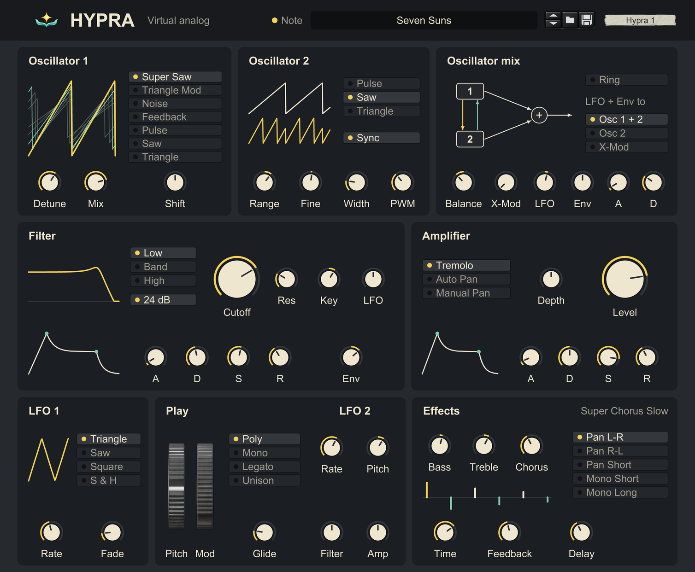

# Trancera

Trancera is a proof of concept of an eight-voice virtual-analog synthesizer
modelling the Roland JP-8000 (1997), meant to become a Reason Rack Extension
once its sound is approved. The owner named it Trancera on 2026-11-23 (it was
Hypra until then). It is an independent
original implementation, not affiliated with or licensed by Roland, and holds
no firmware, ROM data, samples, captured audio or factory patch data. Since
2026-11-23 it is not clean-room: at the owner's risk, constants may be taken
from an analysis of the JP-8000 firmware (tagged `[firmware]`).

**Status: 0.8.0, for listening.** The engine is complete enough to judge the
sound. Its Rack Extension is `Examples/Trancera` in protocodus/reason-rack-extensions.
There is no plug-in, factory preset bank, arpeggiator, split mode or motion
control. The saw, pulse and triangle-mod waveforms and the
filter are fitted to an emulator running the JP-8000's own system software,
played as a black box, and agree with it within 0.2 dB. So are the
envelopes, both LFOs, FADE, the modulation depths, pan, OSC BALANCE, key
follow, portamento, cross mod, ring modulation, the feedback oscillator,
the noise oscillator and the supersaw's Detune at every value (1-1.5 %
median gaps), the tone control, and the delay's times, feedback and level.
The triangle's SHAPE above 0, the velocity matrix and the modulated chorus
types are still estimates.



The panel is a concept, not a built device.

---

## How it works

The JP-8000 is a digital instrument: four Toshiba TC170C140 DSPs compute the
voices and effects, and only the stage from the DAC to the jacks is analogue.
So the model has two halves.

- **The DSP, as behaviour.** 88.2 kHz inside whatever the host rate, naive
  oscillators that alias, 7-bit controls, an 18-bit DAC and, as inferences,
  24-bit phase, uncorrected sync and hard clipping at full scale. There is no
  invented analogue drift, because the hardware has none.
- **The output stage, as a circuit.** The network from the DAC to the line
  jack, solved from the 1997 service notes' component values and discretised
  at 705.6 kHz. Left out: the volume pot's loading, mute transistors,
  ferrites, a 100 ohm / 100 pF RF filter, op-amp limits and noise.

The signal path is `OSC 1 + OSC 2 (sync, ring, X-mod) -> filter -> amp ->
tone control -> delay -> chorus -> pan -> DAC -> output circuit`, for two
parts sharing eight voices. Unison comes from the JP-8080; the JP-8000 has no
unison switch.

[The hardware model](Docs/research/hardware-model-2026-11-22.md) says for
each mechanism whether it is settled by a document, measured by someone else,
or inferred here.

## Known gaps

- Only the supersaw at Detune 0 / Mix 0 on one note, the saw at its round
  end, the 12 dB low-pass, the tone control, the feedback howl's tuning and
  the output stage's tilt have been checked against the hardware
  ([measurements](Docs/research/hardware-ab-2026-11-22.md)). Every
  `[inferred]` law is a placeholder until a recording tests it.
- The feedback oscillator, the effects' modulation settings, the filter
  algorithm and all envelope, LFO and cutoff tapers are inferred.
- The JP-8000's service notes mark a 1.06 kHz pole in the main output which
  the JP-8080's do not have; see `Docs/decisions.md`.
- Split mode, arpeggiator, RPS, motion control, ribbon, velocity assign,
  tempo sync and SysEx are not implemented.
- About 4 % of one Apple silicon core with eight voices at 48 kHz, 2.7 % of
  it the fixed output stage. Not measured in Reason or under phdsp64.

## Version history

| Version | Change |
| --- | --- |
| 0.8.0 | Renamed from Hypra to Trancera (owner, 2026-11-23): the `trancera` namespace, `Source/DSP/Trancera*` files, the `TranceraDSP` library and the repository. No change to the sound. |
| 0.7.1 | The triangle-mod sine table is built at compile time, so the engine holds no global with a run-time initialiser (the Rack Extension toolchain refuses one). No audible change: the table differs from `std::sin` by under 1e-15. |
| 0.7.0 | `Source/DSP/TranceraControls.h` lists the patch as 57 front-panel controls (ids, ranges, defaults) for every front end, with `applyControl` and `controlValue`; the engine takes a host's master tuning (`setTune`). No change to the sound. |
| 0.6.2 | Key follow tracks the pitch after OSC SHIFT; LFO 1 and the pitch envelope reach X-MOD on the pitch-depth curve (they were about a hundred times too strong); effect and delay LEVEL are square-law with a per-type chorus wet gain. Found by playing factory patches on JE-8086 and Trancera. |
| 0.6.1 | Amp SUSTAIN is square-law, as JE-8086 plays it (found by playing ten factory patches on both); the event renderer takes every patch field. |
| 0.6.0 | TONE CONTROL is the measured pair of first-order shelves (treble from 940 Hz, bass below 435 Hz, up to +29 dB at full bass); delay times, feedback and echo levels follow JE-8086, PANNING SHORT answers right first; the two FREEZE PHASE combs take the measured lengths. |
| 0.5.0 | Supersaw Detune follows JE-8086 at every value (steps from 34, a steep climb from 120) and its level drops 1.4 dB; ring modulation 3.6 dB quieter; the feedback oscillator howls exactly on the harmonic JE-8086 picks for each HARMONICS setting, from the same AMOUNT. |
| 0.4.1 | Oscillator SHAPE defaults to 0, as on JE-8086 (it was 64, a brighter wave), and the demo saws use SHAPE 0, the rounder saw of the factory patches, instead of the plain saw at 32. |
| 0.4.0 | Envelope segments start late (25 ms from 30), short attacks are faster, FADE ramps in decibels, LFO 2 has its own rate, amp LFO, pan, OSC BALANCE (constant power), X-MOD (FM in Hz) and the noise oscillator (the main filter on the key) follow JE-8086. Velocity is off by default, as there. |
| 0.3.0 | Envelopes, LFO 1 rate and depths, pitch and filter envelope depths, key follow and portamento follow black-box measurements of JE-8086: one exponential time constant per value for attack, decay and release, a glide of fixed time, key follow at half strength below zero. The demo patches keep their old timing under the new tables. |
| 0.2.0 | The filter, saw SHAPE, pulse width and triangle mod follow black-box measurements of JE-8086: a different filter structure, cutoff a semitone per step, a measured resonance curve, -24 dB as two identical stages. |
| 0.1.3 | Detune and Mix follow Szabo's measured tables instead of his fitted curves: the sides are 14 % quieter at Mix 0. |
| 0.1.2 | The saw's round end and the feedback howl's tuning follow factory-patch recordings. |
| 0.1.1 | The supersaw follows a recorded JP-8080: a four-pole tracked high-pass, which restores its fundamental, and the recorded drift at Detune 0. |
| 0.1.0 | First proof of concept. |

## Build

```sh
cmake -S . -B build-dsp -DCMAKE_BUILD_TYPE=Release
cmake --build build-dsp --parallel 2
ctest --test-dir build-dsp --output-on-failure
./build-dsp/TranceraRenderDemos deliverables/demos
python3 Tools/panel/render_front.py
```

The panel script needs Pillow, the macOS Arial fonts and a
`reason-rack-extension` checkout beside this one for the stock widgets.

## Licensing

Source-available under the [PolyForm Noncommercial licence](LICENSE). Roland,
JP-8000 and JP-8080 are trademarks of Roland Corporation, used only to name
the modelled instrument.
